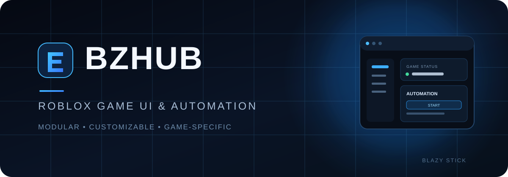

<!-- BZHUB README -->

<div align="center">



<br>

[](https://github.com/blazystick/BZHUB)
[](https://www.lua.org/)
[](https://www.roblox.com/)

**A modular GUI and game-specific automation project for Roblox.**

[Features](#-features) · [Supported Games](#-supported-games) · [Installation](#-installation) · [Project Structure](#-project-structure)

</div>

---

## ✨ Features

<table>
<tr>
<td width="50%">

### 🎨 Modern Interface
Dark design, blue neon accents, smooth animations, and a draggable window.

</td>
<td width="50%">

### 🕹️ Game Detection
Detects the current game's PlaceId and displays its support status.

</td>
</tr>
<tr>
<td width="50%">

### 🌈 Appearance Options
Blue, Purple, Green, and Red themes.

</td>
<td width="50%">

### 🌍 Multiple Languages
English, Turkish, and Russian interface options.

</td>
</tr>
<tr>
<td width="50%">

### 🧩 Modular System
Game-specific code is organized into separate `SupportedGames` modules.

</td>
<td width="50%">

### 🪟 Window Controls
Minimize, resize, and close the interface.

</td>
</tr>
</table>

## 🎮 Supported Games

| Game | PlaceId | Status |
|:--|:--:|:--:|
| Throw Food for Animals | `120219252362013` | 🟢 Supported |

> BZHUB loads game-specific modules only for games registered as supported in the main script. The supported games list may change over time.

## 🧭 Interface Sections

| Section | Description |
|:--|:--|
| **Home** | Welcome screen and general status |
| **Information** | Interface usage information (available in supported games) |
| **Settings** | Theme and language options |
| **Automation** | Automation controls provided by the game module |

## 📁 Project Structure

```text
BZHUB/
├── assets/
│   └── bzhub-banner.svg
├── SupportedGames/
│   ├── 120219252362013.lua
│   ├── 120219252362013_2.lua
│   ├── 91704854174760.lua
│   └── 91704854174760_2.lua
└── main.lua
```

- **`main.lua`** — Main interface, game detection, and shared systems.
- **`SupportedGames/`** — Lua modules containing game-specific features.
- **`assets/`** — README and project visuals.

## 🚀 Installation

1. Open the [BZHUB repository](https://github.com/blazystick/BZHUB).
2. Select **Code → Download ZIP** to download the project files.
3. Join a supported Roblox game.
4. Execute `main.lua` using your Roblox Lua executor.
5. Check the game status displayed in the BZHUB interface.

## 🛠️ Development

When adding support for a new game, keep game-specific code in `SupportedGames/<PlaceId>.lua` whenever possible. Avoid changing the shared interface and systems in `main.lua` unless necessary.

## ⚠️ Disclaimer

- BZHUB is not developed, endorsed, or officially supported by Roblox.
- Using third-party scripts and executors may pose risks to your account or device.
- Only execute code from sources you trust.
- Roblox game updates may affect the functionality of game modules.

---

<div align="center">

**BZHUB** · Made by **blazystick**

<sub>Built for a cleaner and more organized Roblox GUI experience.</sub>

</div>
